  

# Olá, eu sou o Arthur Rosário 👋
 
🎓 Estudante de **Análise e Desenvolvimento de Sistemas**
📍 Aquiraz, Ceará, Brasil
🚀 Construindo minha jornada em **desenvolvimento de software**, com foco em **back-end**
 
---
 
## 🧑‍💻 Sobre mim
 
- 🗄️ Meu foco principal é **back-end**, com ênfase em **banco de dados MySQL**
- 🐘 Tenho noções de **PHP** e estou evoluindo a cada projeto
- 📚 Sempre estudando, praticando e aprendendo com a comunidade
- 🌱 Em busca de oportunidades de estágio ou primeiro emprego na área de tecnologia
---
 
## 🛠️ Tecnologias e ferramentas
 

 
---
 
## 📈 Estudando agora
 
- Modelagem e consultas avançadas em **MySQL** (JOINs, subqueries, views, procedures)
- Fundamentos de **PHP** e lógica de back-end
- Boas práticas com **Git e GitHub**
---
 
## 📊 Estatísticas do GitHub
 

 

 
---
 
## 📫 Vamos conversar?
 

 
---
 
⭐ *Obrigado por passar por aqui! Fique à vontade para explorar meus repositórios.*
